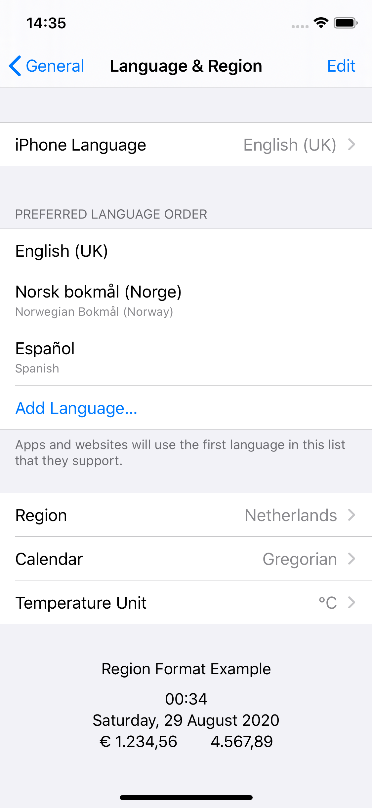
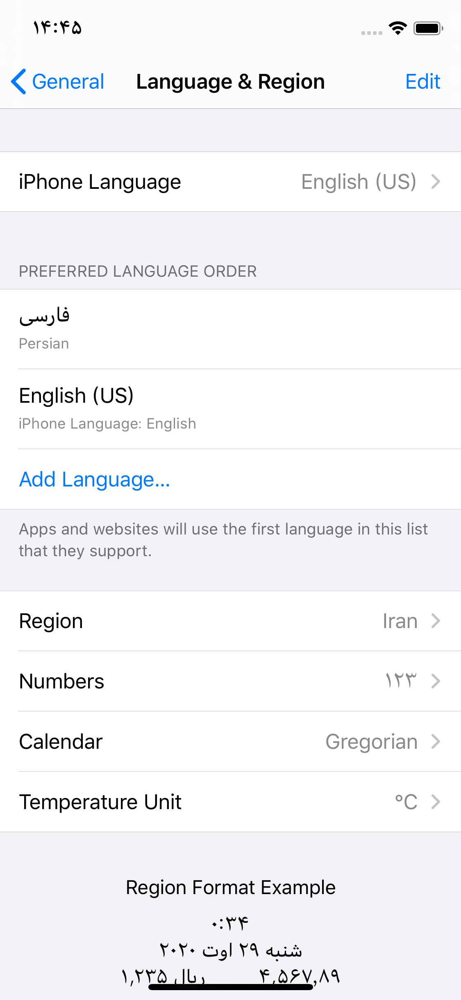

> **Updated November 2026:** The APIs below still behave the same on current iOS. I have replaced `Locale.current.languageCode`, which is deprecated since iOS 16, with `Locale.current.language.languageCode?.identifier`, corrected the comparison in the last section to use `Bundle.main.preferredLocalizations`, and added a section on per-app languages, which users can pick since iOS 13.

When localising your app, you might need to get the user's preferred language, for example for sending it to the backend. There are several ways to do this, let's have a look at the available APIs Apple provides.

## Locale.current

`Locale` consists of region and language and is mostly used for formatting text such as currency and dates.

The user's region information is found at the bottom of Settings → General → Language & Region). It is perfectly reasonable to choose another region than the language you'd like the have the phone in. An American living in Norway might like to have the phone language set to American English while using the metric system and a 24-hour clock.

Now, for the language, `Locale` will find the best match between the languages that your app supports and the user preferred languages. The first language in the preferred list that exists in the app will be chosen.

## Locale.preferredLanguages

This returns a list of the user's preferred languages, in the order they are specified. Note that this list might include more than (or none of) the languages your app supports.

In this example, `Locale.preferredLanguages` will give `["en-GB", "nb-NO", "es-NL"]`.

Also note that the user's preferred language might not be supported by iOS itself, such as Persian:

In this case, `Locale.preferredLanguages` will give `["fa-IR", "en-US"]`.

## Bundle.main.localizations

This will return an array of strings containing all the localisations supported by the app.

## Bundle.main.preferredLocalizations

This is a subset of `Bundle.main.localizations` filtered and sorted according to the user's preferred languages. This means that `Bundle.main.preferredLocalizations.first` will be equal to `Locale.current.language.languageCode?.identifier`. Before iOS 16, the language code was read with `Locale.current.languageCode`, which is now deprecated.

## Per-app language

Since iOS 13, users can also pick a language for a single app, on that app's page in Settings, separately from the language of the phone. `Bundle.main.preferredLocalizations` reflects that choice, so it is the one to read when you need the language the app is actually shown in.
