<style>
.post-content table {
  display: block;
  max-width: 100%;
  overflow-x: auto;
  -webkit-overflow-scrolling: touch;
}

.dice-device-photo {
  margin: 1.5rem auto;
  max-width: 520px;
  text-align: center;
}

.dice-hero-photo {
  margin: 0 auto 2rem;
  max-width: 860px;
  text-align: center;
}

.dice-photo-grid {
  display: grid;
  grid-template-columns: repeat(auto-fit, minmax(220px, 1fr));
  gap: 1rem;
  margin: 1.5rem 0;
}

.dice-photo-grid figure {
  margin: 0;
}

.dice-photo-grid img,
.dice-hero-photo img,
.dice-device-photo img {
  border-radius: 4px;
  display: block;
  height: auto;
  width: 100%;
}

.dice-photo-grid figcaption,
.dice-hero-photo figcaption,
.dice-device-photo figcaption {
  margin-top: 0.4rem;
}
</style>

## The Coldcard incident, briefly

On July 30, 2026, an [independent investigation by Block](https://engineering.block.xyz/blog/predictable-rng-fallback-and-32-bit-reseed-in-coldcard-firmware) disclosed that affected [Coldcard](https://coldcard.com/) firmware could use predictable randomness when generating seeds on the device. The defect had entered released firmware in March 2021. Attackers were able to derive keys and steal bitcoin from affected wallets.

| Date | What happened |
| --- | --- |
| March 17, 2021 | The affected RNG integration appeared in the [version 4.0.0 source tag](https://github.com/Coldcard/firmware/tree/2021-03-17T1724-v4.0.0). |
| March 29, 2021 | Version 4.0.1 began the affected Mk2/Mk3 firmware range identified in [Coinkite's current advisory](https://blog.coinkite.com/coldcard-mk3-seed-generation-warning/). |
| 2022–2026 | The affected path shipped on the MK4 and later the Q. The dedicated dice-only path continued to derive its entropy from the entered rolls instead. |
| July 30, 2026 | Block published its independent analysis while the vulnerability was being actively exploited. |
| July 31, 2026 | Fixed firmware was released for the Mk2/Mk3 ([`4.2.0`](https://github.com/Coldcard/firmware/tree/2026-07-31T1248-v4.2.0)), Q ([`1.5.0Q`](https://github.com/Coldcard/firmware/tree/2026-07-31T0517-v1.5.0Q)), and MK4/MK5 ([`5.6.0`](https://github.com/Coldcard/firmware/tree/2026-07-31T0519-v5.6.0)). |

Block's report explains the defect and the affected firmware in detail. Here I focus only on whether the dedicated dice-only flow shared that weakness.

## What this article sets out to prove

This article addresses one practical question for existing users: **if you created a 24-word Coldcard seed through the dedicated dice-only flow using at least 99 fair, independent, private rolls, did this RNG bug weaken it?**

The answer is no. In the dedicated dice-only flow, the seed entropy came from the entered rolls, and the code bypassed the firmware path affected by the RNG integration bug. That was true throughout all of the affected pre-hotfix firmware releases.

To demonstrate this independently, I first calculate the expected words with [Ian Coleman's open-source BIP39 tool](https://iancoleman.io/bip39/). I then enter the same rolls on a [SeedSigner](https://seedsigner.com/) and on two Coldcards running affected firmware, before checking the historical Coldcard source to explain why all four results agree.

I tested a Coldcard Q running 1.4.1Q and a Coldcard MK4 running 5.4.5. **I deliberately have not installed the RNG hotfixes on either device.** This tests the dice-only path as it actually behaved while the bug was present.

<figure class="dice-hero-photo">
  <a href="/assets/dice/dice-rolls-hero.jpeg"></a>
  <figcaption>Use physical dice for real wallet entropy. This article uses an intentionally public test sequence generated with RANDOM.ORG.</figcaption>
</figure>

The reassurance in this article is specific to that dedicated 99-roll, 24-word dice-only process.

## First, establish the expected words with Ian Coleman

I began with one public sequence of 99 dice rolls. I generated it using [RANDOM.ORG's Dice Roller](https://www.random.org/dice/), which is acceptable here only because this seed is intentionally public test data. For a real wallet, use a physical die in private; never obtain real seed entropy from an online service.

These are the 99 rolls, in order and without spaces:

```text
133363436436436415622614221225242212144161454643266122155666664444633643543353132626522332412313253
```

I cloned and served [version `0.5.6`](https://github.com/iancoleman/bip39/tree/0.5.6) of the open-source tool behind [iancoleman.io/bip39](https://iancoleman.io/bip39/) locally. To reproduce the result:

1. Open **Show entropy details**.
2. Paste the 99 rolls into **Entropy**.
3. Select **Base 10 [0-9]** or **Hex [0-9A-F]**.
4. Select **24 Words**.

The expected mnemonic is:

| Words 1–8 | Words 9–16 | Words 17–24 |
| --- | --- | --- |
| 1. wrist | 9. average | 17. chronic |
| 2. tired | 10. crawl | 18. ordinary |
| 3. novel | 11. task | 19. chase |
| 4. fetch | 12. helmet | 20. typical |
| 5. woman | 13. negative | 21. recipe |
| 6. whisper | 14. wrong | 22. sunset |
| 7. jealous | 15. foster | 23. draw |
| 8. black | 16. dry | 24. victory |

Why not select **Dice [1-6]**? Ian Coleman's Dice mode first converts every `6` to `0`, while Coldcard and SeedSigner hash the entered characters exactly as written. Dice mode therefore calculates a different, internally valid seed from a different representation. Base 10 and Hex leave this particular input unchanged, so they match the devices being tested.

For real seed material, obtain and verify the tool in advance and run it on an offline system such as [Tails](https://tails.net/). Never paste a real seed or its dice rolls into the online website.

## Then compare the physical devices

I entered the exact same 99 characters on three physical devices:

| Device | Setup | Result |
| --- | --- | --- |
| Coldcard Q | Firmware [`1.4.1Q`](https://github.com/Coldcard/firmware/tree/2026-07-01T1728-v1.4.1Q); deliberately not updated with the hotfix | Same 24 words |
| Coldcard MK4 | Firmware [`5.4.5`](https://github.com/Coldcard/firmware/tree/2025-11-03T1527-v5.4.5); deliberately not updated with the hotfix | Same 24 words |
| SeedSigner | Version [`0.8.7`](https://github.com/SeedSigner/seedsigner/tree/0.8.7) on a [Raspberry Pi Zero v1.3](https://www.raspberrypi.com/products/raspberry-pi-zero/) | Same 24 words |

The Coldcards were running affected, pre-hotfix firmware. SeedSigner provides an independent implementation with no Coldcard code in common. All three produced the Ian Coleman reference result, word for word. Photographs of every word appear below.

> **Everything in this test is public data. Never send bitcoin to this seed.** A photograph of a real seed is a complete compromise. Keep real rolls, words, hashes, photographs, and terminal history secret.

## Why dice-only seeds were safe

The historical firmware makes the key distinction clear. Normal seed generation used the firmware path affected by the RNG integration bug. The dedicated [dice-only flow from the affected 2021 firmware](https://github.com/Coldcard/firmware/blob/2021-03-17T1724-v4.0.0/shared/seed.py#L334-L346) instead started empty and derived the seed entropy solely by hashing each entered dice value.

```text
99 dice rolls → SHA-256 → 24 BIP39 words
```

Each fair six-sided roll contributes about 2.585 bits of entropy, so 99 independent rolls provide approximately 255.9 bits.

Because the dice-only flow bypassed that affected path, no internally generated randomness entered the calculation. The same dice-only construction appears in the [first MK4 firmware from 2022](https://github.com/Coldcard/firmware/blob/2022-03-14T1907-v5.0.0/shared/seed.py#L292-L362), [MK4 5.4.5](https://github.com/Coldcard/firmware/blob/2025-11-03T1527-v5.4.5/shared/seed.py#L377-L481), and [Q 1.4.1Q](https://github.com/Coldcard/firmware/blob/2026-07-01T1728-v1.4.1Q/shared/seed.py#L380-L484).

Published before this article, an independent [function-level audit of the dice-only path in MK4/MK5 firmware 5.6.0](https://github.com/portlandhodl/coldcard_fw_dicerolls_trace/blob/main/dice-roll-5-6-0.pdf) likewise recorded an empty entropy accumulator, one update for every entered roll, and no RNG or TRNG call. That audit covers fixed firmware, so it complements rather than replaces the historical source and pre-hotfix device tests here.

That source history covers the vulnerable period, while the physical tests show the result on affected firmware. Together they support the conclusion: **a 24-word seed made through the dedicated dice-only flow with at least 99 fair, private, correctly entered rolls was not weakened by this RNG bug.**

This article tests only the dedicated dice-only generation/import flow. The separate **Add Dice Rolls** workflow begins with a device-generated seed and then hashes every entered roll into it. According to [Coinkite's advisory](https://blog.coinkite.com/coldcard-mk3-seed-generation-warning/), at least 50 fair, independent, private rolls supplied enough independent entropy that the resulting seed is not considered at risk from this RNG issue alone. If you added fewer than 50 rolls, do not remember how many you added, or are unsure whether the rolls remained private, follow the advisory's migration guidance.

## Physical-device evidence

### Coldcard Q 1.4.1Q

The Q displayed all 24 expected words on one screen while still running the affected 1.4.1Q firmware:

<figure class="dice-device-photo">
  <a href="/assets/dice/coldcard-q-1.4.1q-seed-words-redacted.png">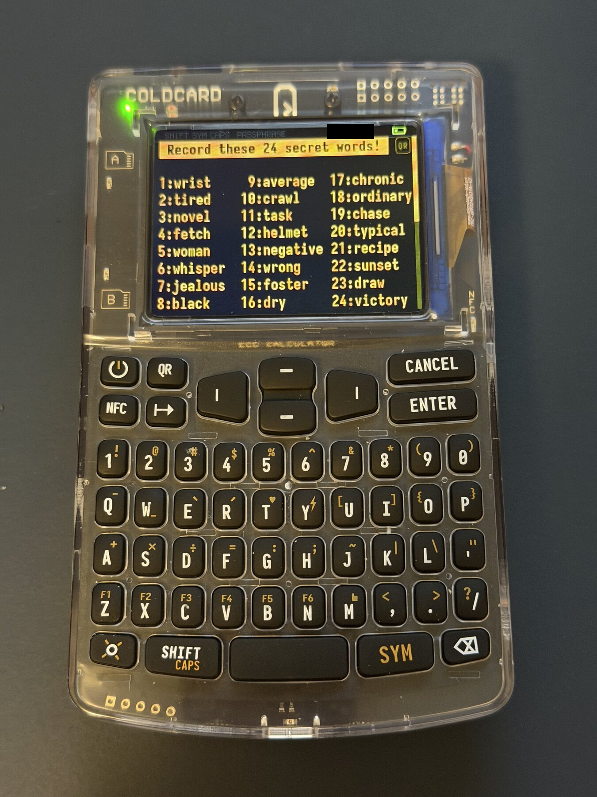</a>
  <figcaption>Coldcard Q running pre-hotfix firmware 1.4.1Q. The status-bar fingerprint has been redacted because it belonged to the wallet active before the public test seed was committed.</figcaption>
</figure>

### Coldcard MK4 5.4.5

The MK4, also intentionally left on affected firmware, showed the same mnemonic in five scrolling positions:

<div class="dice-photo-grid">
  <figure>
    <a href="/assets/dice/coldcard-mk4-5.4.5-seed-words-01-05.jpeg">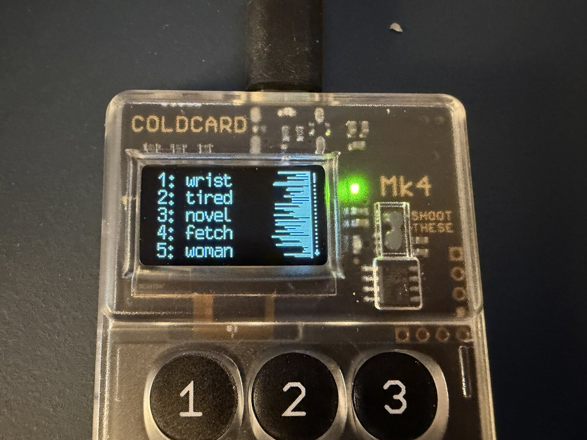</a>
    <figcaption>Words 1–5</figcaption>
  </figure>
  <figure>
    <a href="/assets/dice/coldcard-mk4-5.4.5-seed-words-06-10.jpeg">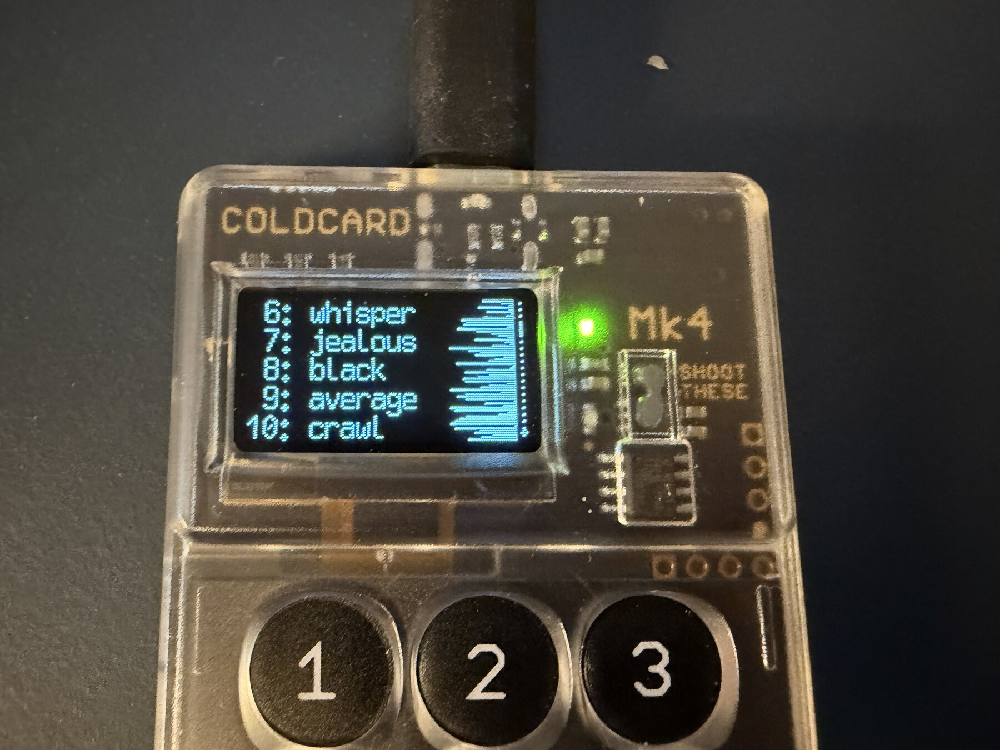</a>
    <figcaption>Words 6–10</figcaption>
  </figure>
  <figure>
    <a href="/assets/dice/coldcard-mk4-5.4.5-seed-words-11-15.jpeg">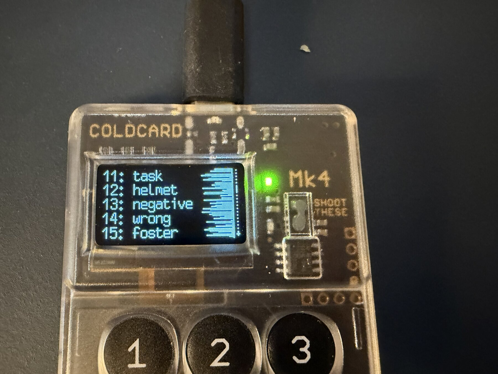</a>
    <figcaption>Words 11–15</figcaption>
  </figure>
  <figure>
    <a href="/assets/dice/coldcard-mk4-5.4.5-seed-words-16-20.jpeg">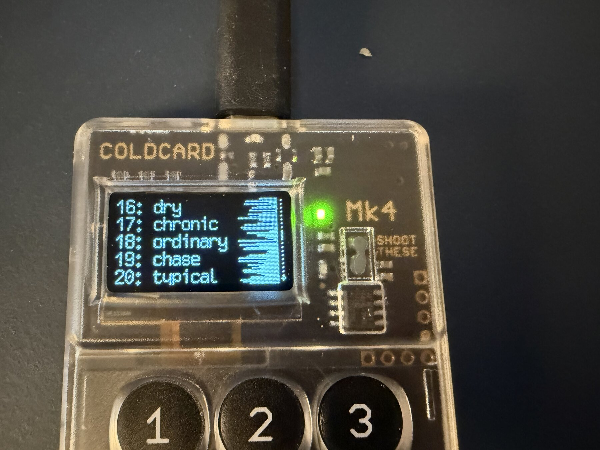</a>
    <figcaption>Words 16–20</figcaption>
  </figure>
  <figure>
    <a href="/assets/dice/coldcard-mk4-5.4.5-seed-words-21-24.jpeg">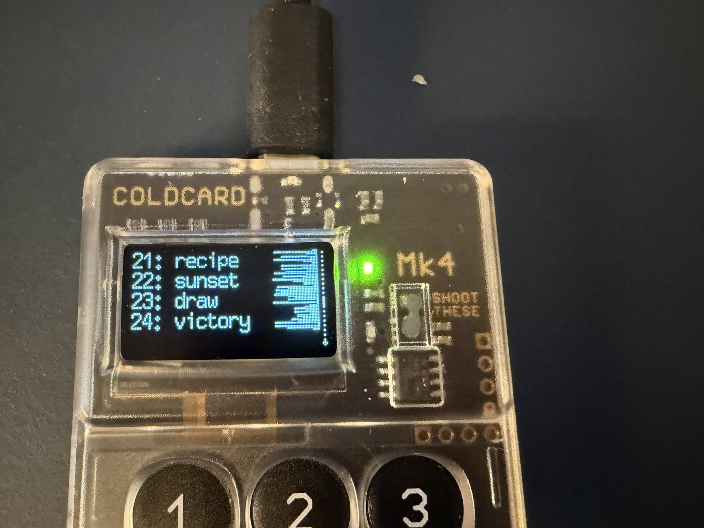</a>
    <figcaption>Words 21–24</figcaption>
  </figure>
</div>

Coldcard's firmware repository also includes [`docs/rolls.py`](https://github.com/Coldcard/firmware/blob/2025-11-03T1527-v5.4.5/docs/rolls.py), a short Python script that hashes an entered dice-roll sequence and converts it into 24 BIP39 words. I ran it as a project-supplied cross-check. It is not independent evidence because it comes from the same repository:

```shell
printf '%s\n' '133363436436436415622614221225242212144161454643266122155666664444633643543353132626522332412313253' | python3 docs/rolls.py
```

It returned the expected SHA-256 digest and all 24 words.

### SeedSigner 0.8.7 on Raspberry Pi Zero v1.3

SeedSigner provides an independent implementation and has no Coldcard code in common. I entered the same rolls on version 0.8.7 running on a Raspberry Pi Zero v1.3. It displayed the expected words over six screens.

<div class="dice-photo-grid">
  <figure>
    <a href="/assets/dice/seedsigner-0.8.7-seed-words-01-04.jpeg">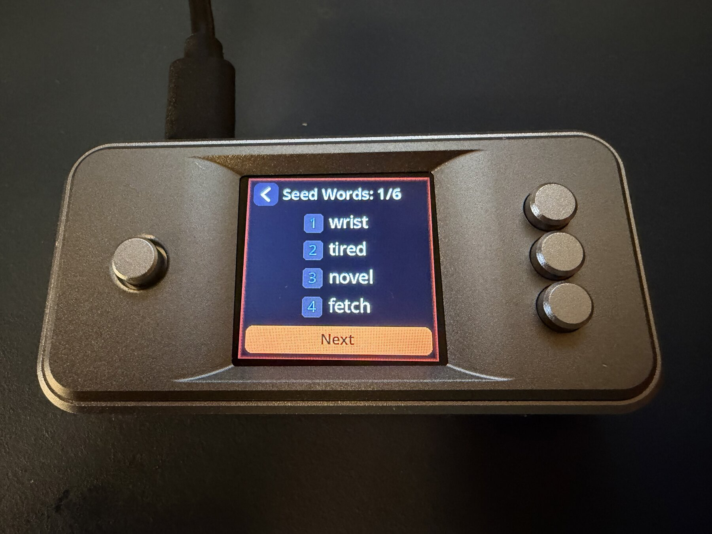</a>
    <figcaption>Words 1–4</figcaption>
  </figure>
  <figure>
    <a href="/assets/dice/seedsigner-0.8.7-seed-words-05-08.jpeg">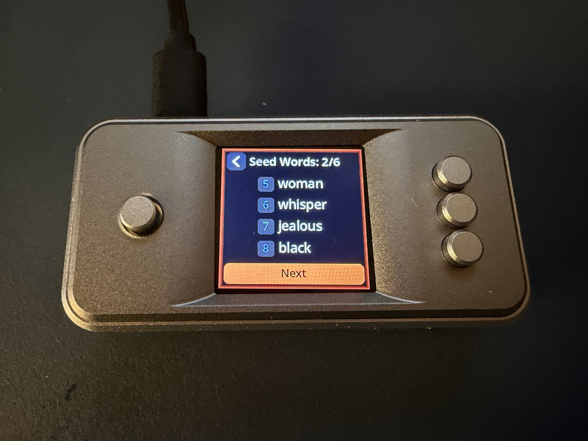</a>
    <figcaption>Words 5–8</figcaption>
  </figure>
  <figure>
    <a href="/assets/dice/seedsigner-0.8.7-seed-words-09-12.jpeg">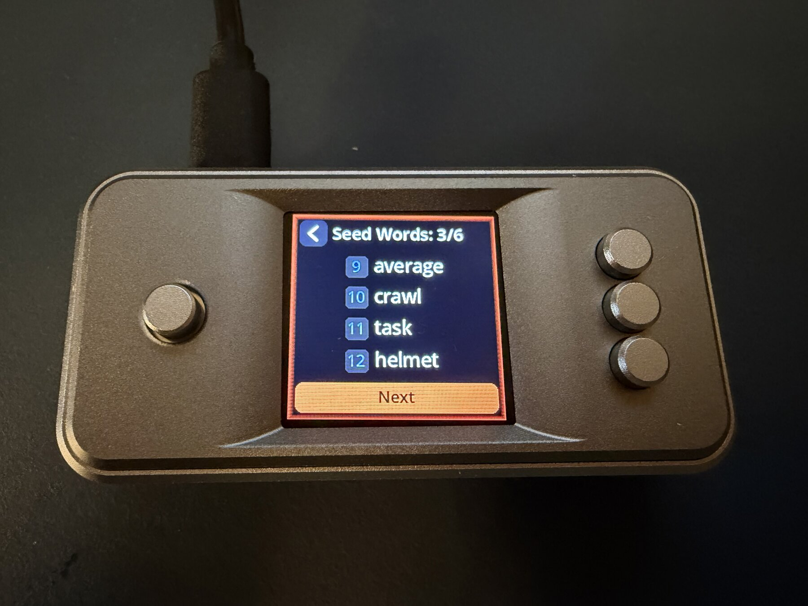</a>
    <figcaption>Words 9–12</figcaption>
  </figure>
  <figure>
    <a href="/assets/dice/seedsigner-0.8.7-seed-words-13-16.jpeg">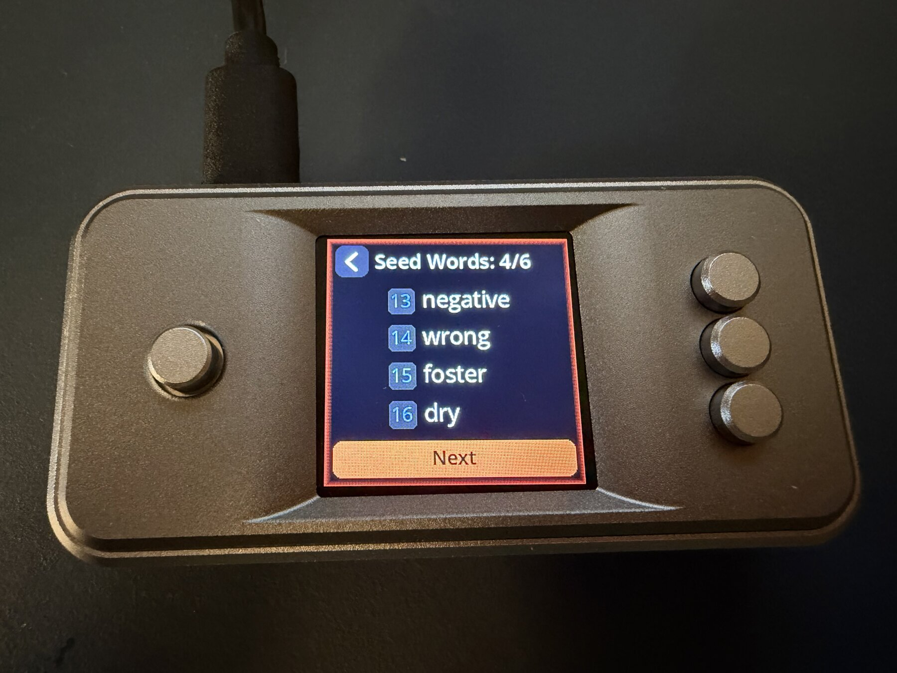</a>
    <figcaption>Words 13–16</figcaption>
  </figure>
  <figure>
    <a href="/assets/dice/seedsigner-0.8.7-seed-words-17-20.jpeg">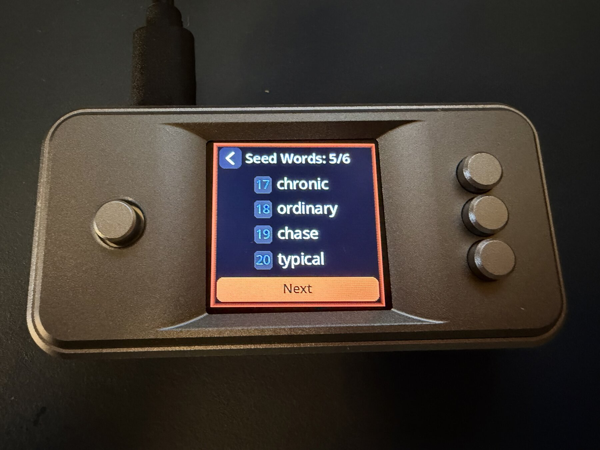</a>
    <figcaption>Words 17–20</figcaption>
  </figure>
  <figure>
    <a href="/assets/dice/seedsigner-0.8.7-seed-words-21-24.jpeg">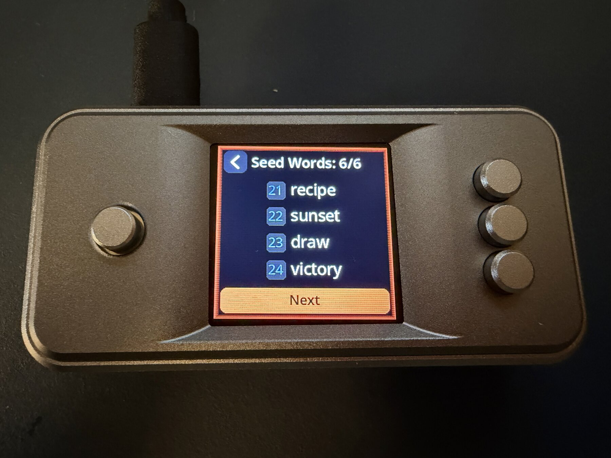</a>
    <figcaption>Words 21–24</figcaption>
  </figure>
</div>

SeedSigner's [`generate_mnemonic_from_dice`](https://github.com/SeedSigner/seedsigner/blob/e0a80d4b33b8eb7fb1e9fd14a27b7cd11c7d2cd6/src/seedsigner/helpers/mnemonic_generation.py) performs the same deterministic calculation. I checked out the release used on the device and ran its host-side tool:

```shell
git switch 0.8.7
.venv/bin/python tools/mnemonic.py dice 133363436436436415622614221225242212144161454643266122155666664444633643543353132626522332412313253
```

It returned the same words. SeedSigner also publishes a [dice-seed verification guide](https://github.com/SeedSigner/seedsigner/blob/e0a80d4b33b8eb7fb1e9fd14a27b7cd11c7d2cd6/docs/dice_verification.md).

## What this proves—and what it does not

Ian Coleman and SeedSigner independently produce the same 24 words. Both Coldcards produce those words while running affected, pre-hotfix firmware. The historical source explains why: the dedicated dice-only flow hashes the entered rolls without using the firmware path affected by the RNG integration bug.

This does **not** prove that a particular historical user used the dice-only menu, rolled a fair die 99 times, entered every roll correctly, or kept the sequence private. Nor does it make a device-generated seed safe. Those are facts no public test can recover afterward.

It proves the narrower claim this article set out to test: the Coldcard RNG bug does not enter the dedicated dice-only calculation, and affected firmware correctly turns this 99-roll sequence into the independently expected 24 words.

If you know that your 24-word seed came from the dedicated dice-only flow with at least 99 fair, private rolls—even if you made it at any point between the bug's introduction in March 2021 and the fixed firmware releases on July 31, 2026—this RNG bug did not weaken that seed. If you are unsure how your existing seed was generated, the safer choice is to create a new seed using a method you can verify and carefully move your funds to the new wallet rather than continue relying on the old one.
